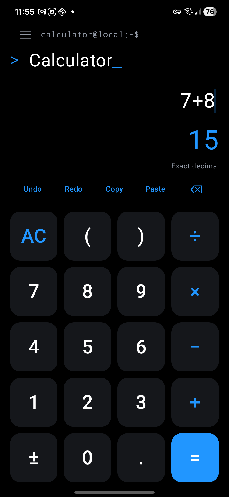

# UI, editor and haptic refinement

The current implementation preserves the arithmetic engine and its eight regression tests.

## Modified files

- ui/components/ExpressionEditor.kt: custom Text rendering, text-layout hit testing, blinking cursor, cursor-following horizontal scrolling, tap positioning, long-press select-all, selection replacement and character deletion. No TextField, input connection or IME focus target. TextFieldValue is only the saveable text/selection data model.
- ui/screens/CalculatorScreen.kt: custom editor integration, modern clipboard API, immediate touch-down haptics, 85 ms key animation, fixed responsive keypad.
- feedback/HapticFeedbackManager.kt: cached native effects and vibrator service, capability detection, system touch settings, no interruption-policy bypass, short number/operator/equals/clear/navigation feedback. Old Android compatibility paths use the APIs available on those releases.
- data/SettingsRepository.kt: persistent Off / Light / Medium / Strong / Maximum intensity. Strong is the new default. A previously saved explicit Off setting remains Off.
- CalculatorViewModel.kt: removed fixed preview delay; evaluation and result formatting run on Default; canceled previews cannot publish stale results; no-op edits preserve undo/redo.
- ui/CalculatorApp.kt: compact drawer terminal header and animated item colors, navigation feedback, saved intensity integration.
- ui/screens/ModuleScreens.kt: interaction settings category and radio selector; existing history/About retained.
- ui/theme/TerminalTheme.kt: typography matched to Gallery's FontFamily.Default content and FontFamily.Monospace terminal elements, with the existing blue palette.
- AndroidManifest.xml: normal VIBRATE permission; no internet permission added.
- app/src/test/java/com/example/calculator/ExpressionEditingTest.kt: six editing regression tests.

## Executed validation

`.\gradlew.bat :math-engine:test :app:testDebugUnitTest :app:assembleDebug :app:lintDebug --offline --console=plain`

Passed: eight engine tests, six editor tests, existing app unit test, debug compilation and lint (advisory warnings remain).

Samsung SM-S9310, 1080x2340: installed and ran the build. Checked insertion into 1234 to produce 19234, deletion to restore 1234, long-press replacement, 16 rapid digit presses without loss, no EditText/visible IME, no vertical calculator ScrollView, saved Maximum intensity after force-stop/relaunch, switching back to Strong, drawer/Back navigation and 7+8 = 15. Android vibrator logs confirmed TOUCH usage, no bypass flags and Strong amplitude 0.78 for 14 ms number feedback. Physical feel cannot be judged remotely.

The reproducible ADB smoke check is verify_refinement.py. It is calibrated to the connected Samsung's layout and changes only this app's input/settings. It leaves Strong selected. The final source additionally moves result string formatting to the worker dispatcher; it was compiled, linted and unit-tested afterward.

## Limits

Long press selects all; draggable partial-selection handles are intentionally not implemented. Taps place the cursor for individual insertion/deletion. Hardware without amplitude control may map several levels to identical strength; Settings explains this. Android system settings can suppress or scale feedback. Tablet/font-scale/landscape coverage and 60/90/120 Hz frame-time profiling remain to be done. No fixed refresh-rate cap was added.

